<p align="center"></p>

# JellyFlix plugin

The server side of [JellyFlix](https://github.com/yourmomsbasement/JellyFlix-Web), a Netflix-style Jellyfin. One plugin
that does all of this:

- **Profiles**: one household login, several Netflix-style profiles ("Who's watching?"). Each profile is a hidden
  Jellyfin user, so watch history, Continue Watching, Next Up and parental controls are tracked per profile. Optional
  4-digit PINs and kids profiles, and avatars: generated icons on a choice of colors, or an uploaded photo.
- **Recommendations**: Top Picks, "Because you watched…", "More Like This" and the match percentage, learned from each
  profile's history. See [how it works](#how-recommendations-work).
- **Requests**: search shows movies and shows that aren't in the library, with a **Request** button that goes
  through [Seerr](https://github.com/seerr-team/seerr) (Jellyseerr / Overseerr) or [Ombi](https://ombi.io). See
  [requests](#requests).
- **Search by description**: "space movie with a stranded astronaut" finds titles by their plot, tagline, genres,
  keywords and cast, and by meaning too with an embeddings API. See [search by description](#search-by-description).
- **Artwork per profile**: each profile can pick its own poster and background for a title without changing them for
  anyone else. See [artwork per profile](#artwork-per-profile).
- **End-credit companion**: when a movie ends, the next film in its collection, its extras, its soundtrack and more
  like it. See [end-credit companion](#end-credit-companion).
- **Seasonal themes and dynamic colors**: Halloween, Christmas and summer looks for the home page with curated
  shelves, and accent colors taken from each title's artwork. See [appearance](#appearance).
- **Web client**: downloads the JellyFlix web client from
  [JellyFlix-Web releases](https://github.com/yourmomsbasement/JellyFlix-Web/releases), serves it in place of Jellyfin's
  own and keeps it up to date.

<p align="center">

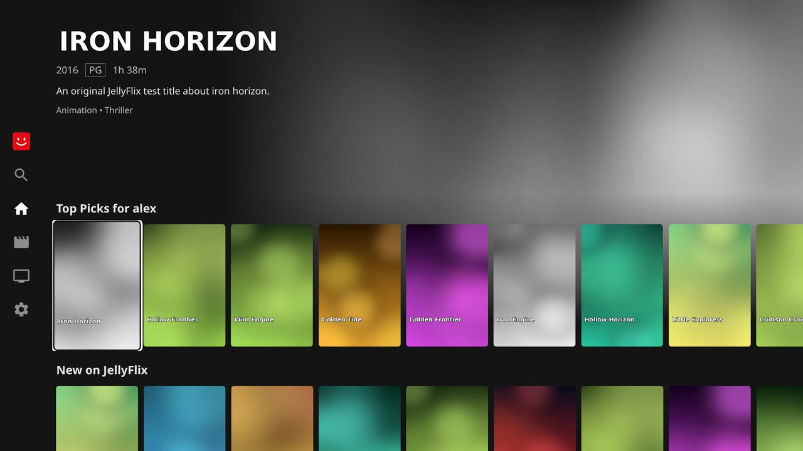
</p>

Requires **Jellyfin 13** (the `unstable` builds), the same version as the JellyFlix web client.

## Install

1. In Jellyfin, open **Dashboard → Plugins → Repositories** (Catalog → ⚙ on some versions) and add a repository:
   - Name: `JellyFlix`
   - URL: `https://raw.githubusercontent.com/yourmomsbasement/JellyFlix-Plugin/main/manifest.json`
2. Install **JellyFlix** from the catalog and restart Jellyfin.

That's it. On startup the plugin downloads the newest JellyFlix web client built for your Jellyfin version and serves it
at `/web` in place of the stock one, on Linux, Docker and Windows alike: no `--webdir`, environment variable or file
copying. New releases are installed automatically at startup and every six hours, and Jellyfin package upgrades no
longer replace the JellyFlix web client.

Settings live under **JellyFlix → Settings** in the dashboard's side menu (or **Dashboard → Plugins → JellyFlix**), and
the dashboard home gets a JellyFlix card. See [settings](#settings).

<p align="center">
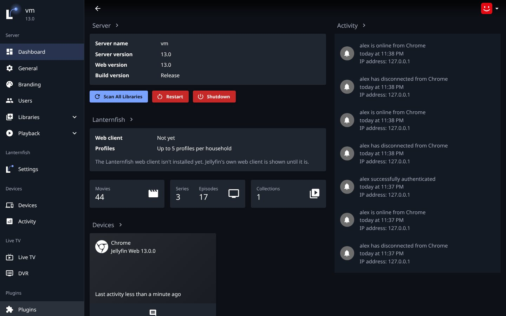
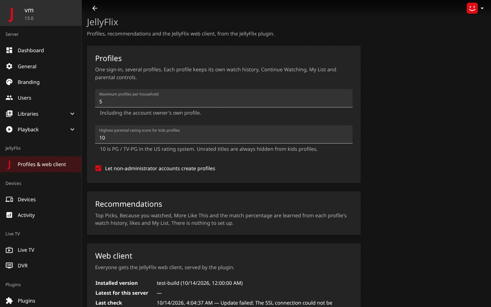
</p>

**Updating:** new plugin versions show up in **Dashboard → Plugins**; update JellyFlix there and restart Jellyfin.
The settings page tells you when a setting needs a newer plugin than the one installed.

**Upgrading from the separate *JellyFlix Profiles* / *JellyFlix Recommendations* plugins:** just install this one.
On its first start it removes the old plugins, carries their settings over and asks for one more restart (the dashboard
shows *Restart required*). Households and profiles are kept.

**Getting Jellyfin's own web client back:** untick **Serve the JellyFlix web client** in the JellyFlix settings. If
the web client itself is broken and you can't reach the dashboard, set `<ServeWebClient>false</ServeWebClient>` in
`plugins/configurations/JellyFlix.xml` in Jellyfin's data folder (or delete the `jellyflix-web` folder there) and
restart Jellyfin.

## Settings

| Setting | Default | What it does |
| --- | --- | --- |
| Maximum profiles per household | 5 | Including the account owner's own profile. |
| Highest parental rating score for kids profiles | 10 | 10 is PG / TV-PG; unrated titles are always hidden from kids profiles. |
| Let non-administrator accounts create profiles | On | Otherwise only administrators can have profiles. |
| Let profiles request titles that aren't in the library | Off | Shows request cards in search (needs Seerr or Ombi below). |
| Request service | Seerr | Seerr (Jellyseerr / Overseerr) or Ombi. |
| Seerr address / API key | — | Where Seerr runs and its API key (Seerr → Settings → General). |
| Ombi address / API key | — | Where Ombi runs and its API key (Ombi → Settings → Ombi). |
| Let kids profiles request titles | Off | Kids profiles don't see request cards otherwise. |
| Match descriptions by meaning (semantic search) | Off | Also match descriptions by meaning, using the embeddings API below. |
| Embeddings API address / model / API key | — / `nomic-embed-text` / — | An OpenAI-compatible embeddings API, e.g. Ollama. |
| Seasonal home page | Automatic | Automatic, Off, Halloween, Christmas or Summer. |
| Dynamic interface colors | On | Accent colors from the selected title's artwork. |
| Serve the JellyFlix web client | On | Serve JellyFlix at `/web`; off gives Jellyfin's own web client back. |
| Install new JellyFlix web releases automatically | On | At startup and every six hours. |
| Release repository | `yourmomsbasement/JellyFlix-Web` | Where web client releases come from. |

Saving reads the settings back from the server and names any it didn't keep (for example, a setting an older plugin
doesn't have). **Save and test connection** (for Seerr and for the embeddings API), **Build search index now** and **Check for
updates now** each show their result in a panel underneath:
a progress bar while they run, then whether it worked and, if not, why.

## Requests

In the JellyFlix settings, turn on **Requests**, pick the request service (**Seerr** for Jellyseerr / Overseerr, or
**Ombi**), enter its address (e.g. `http://192.168.1.10:5055` for Seerr, `http://192.168.1.10:3579` for Ombi) and API
key, then press **Save and test connection**. A panel underneath confirms the connection and the service's version, or
shows the service's own error (such as an invalid API key) and what to check.

<p align="center">
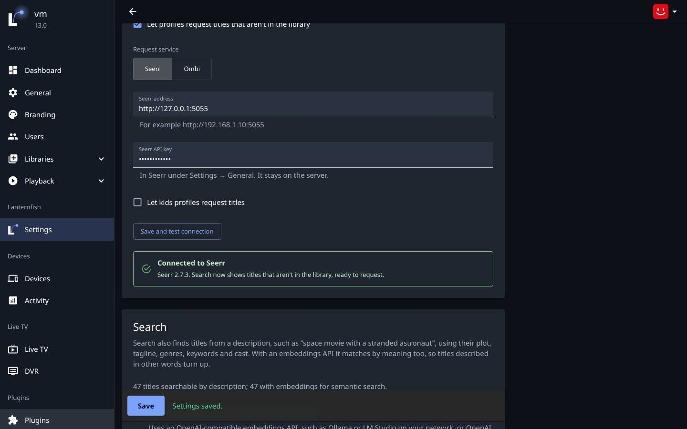

</p>
<p align="center">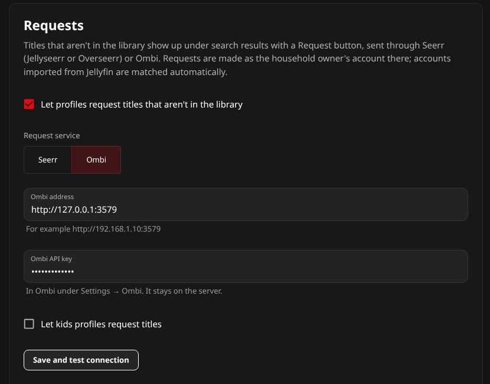</p>

- Search results get a **Not in your library** row: matching movies and shows that the library doesn't have, with
  what's already requested or on its way. Titles that are in the library, and people, are left out.
- **Request** asks for the movie, or every season of a show. Profiles aren't users of the request service, so the
  request is made as the household owner's account there:
  - **Seerr**: users imported into Seerr from Jellyfin are matched by their Jellyfin account automatically; without a
    match, the request is made as the API key's user.
  - **Ombi**: the Ombi user with the owner's Jellyfin user name (users imported from Jellyfin keep it) makes the
    request, so their request limits and auto-approval apply; without one, the request is made as Ombi's API user,
    labelled with the owner's name.
- The service's own permissions, quotas and approval rules apply, and its reason for refusing a request is shown on
  the card.
- Ombi's search doesn't say what's already requested, so the plugin looks up the first 12 results' status in Ombi
  (at the same time) before showing them.
- Kids profiles don't see the row unless **Let kids profiles request titles** is on.
- API keys stay on the server: browsers only talk to the plugin.

## Appearance

**Seasonal home page.** Automatic shows Halloween through October, Christmas from December 1 to New Year's Day, and
summer from June 21 to August 31 (northern hemisphere); any season can also be forced, or turned off. In season, the
web client gives the home page the season's accent color and artwork, and the plugin builds its curated shelves:

| Season | Shelves |
| --- | --- |
| Halloween | **Halloween Picks** (plots, taglines and tags mentioning ghosts, witches, haunted houses, zombies…), **Not Too Scary: Family Frights** (the same, from Family and Animation), **Scream-Worthy Horror** |
| Christmas | **Holiday Favorites** (Christmas, Santa, snow, elves, winter…), **Cozy Family Movie Night** |
| Summer | **Summer Vibes** (beaches, vacations, surfing, islands, camp…), **Summer Blockbusters** (Action and Adventure) |

Words are matched with the same stemming as search by description, so "witches" finds "witch". A title appears on one
shelf at most, best matches and best rated first; shelves with fewer than three titles are left out. Only titles the
profile may see are used, so kids profiles get kids' titles.

<p align="center">
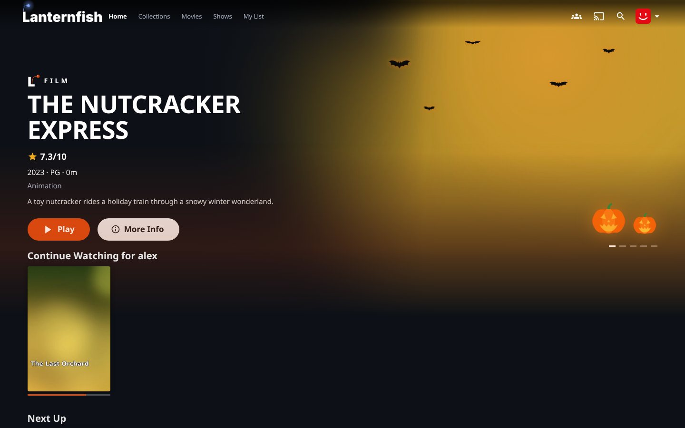
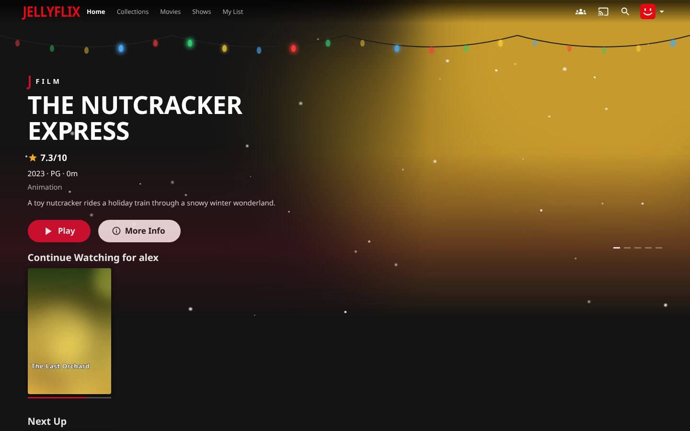
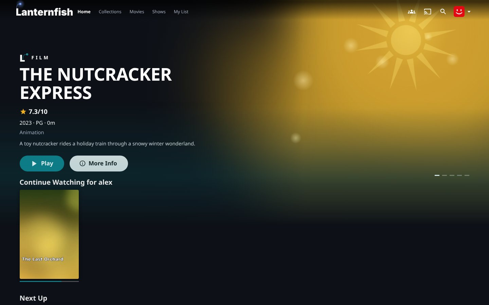
</p>

**Dynamic interface colors.** The web client samples the selected title's artwork, finds its most prominent vivid
color and tones it down until white text on it is readable, then uses it for buttons, progress bars and a soft
background glow. It all happens in the browser; the plugin only stores the setting.

<p align="center">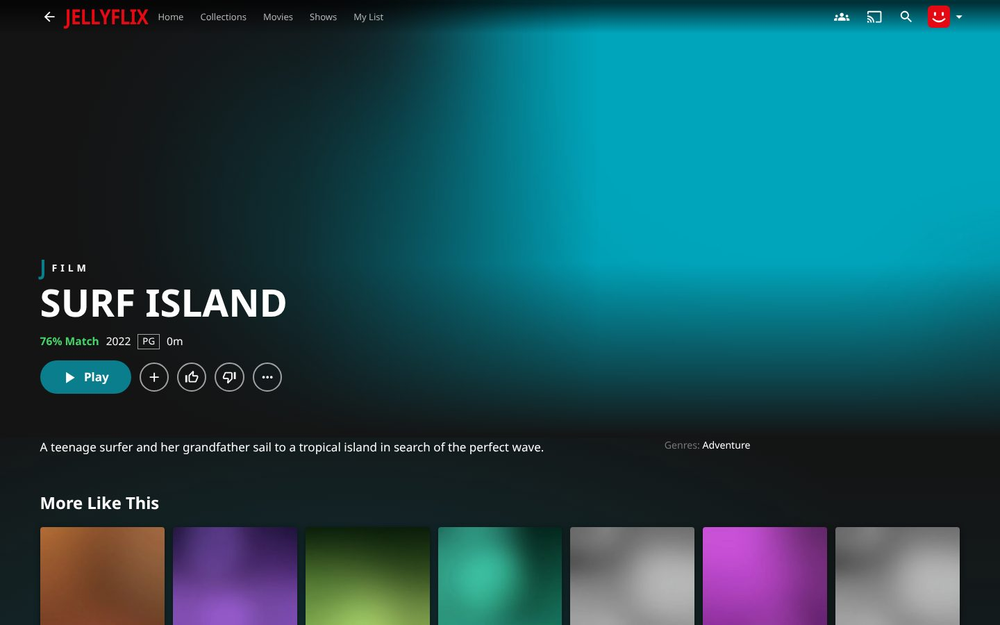</p>

## Profile avatars

In **Manage Profiles**, each profile picks one of 18 generated icons on one of 10 colors, rolls a random pair with
**Surprise me**, or uploads a photo. The web client crops photos to a square and shrinks them to 512 px before
uploading. The plugin accepts JPEG, PNG and WebP, recognized by their content rather than the file name, and stores
the photo as the profile's Jellyfin user image, so other Jellyfin apps show it too. Jellyfin's own image endpoint only
lets administrators change other users' images; the plugin's lets the household owner change any profile's.

<p align="center">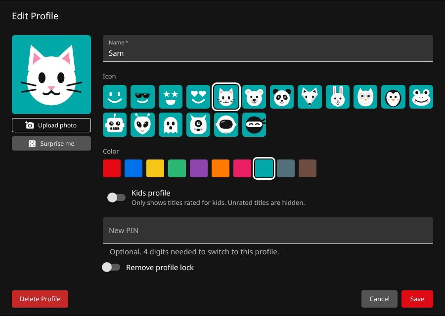</p>

## Search by description

Search also looks for titles whose metadata matches what was typed, so "space movie with a stranded astronaut" finds a
film about an astronaut left on Mars even though its name says nothing of the sort. Matches appear in a **Matches your
description** row under the usual results, leaving out titles the name search already shows.

<p align="center">

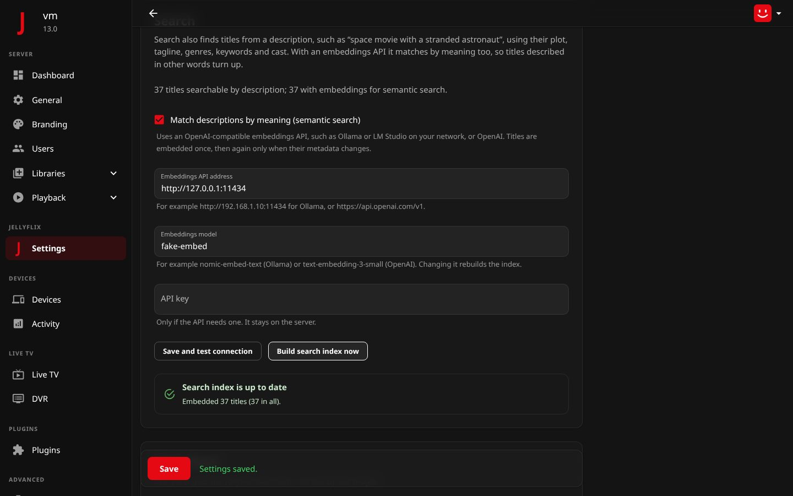
</p>

- **Words, always on.** A full-text (BM25) index of every movie and show: name, original title, tagline, plot, genres,
  tags, studios and the main cast and crew, with the name counting most. Plurals and word endings are folded
  ("stranded" matches "strand"), filler words ("movie", "with", "a") are ignored and weak matches are dropped. It's
  built in memory on first search and rebuilt when the library changes.
- **Meaning, optional.** With **Match descriptions by meaning** on and an OpenAI-compatible embeddings API set up
  (Ollama, LM Studio or OpenAI), each title's description is turned into a vector, and so is the search. Titles close
  in meaning are merged with the word matches, so "marooned on another planet" finds the same film. For Ollama, run
  `ollama pull nomic-embed-text` and enter `http://<ollama-host>:11434`.
- **Save and test connection** embeds a sample and shows the model and its vector size, or the API's error.
  **Build search index now** embeds the titles in the background with a progress bar; the **Build JellyFlix search
  index** scheduled task does the same at startup and daily. Only new titles, and titles whose metadata changed, are
  embedded again; changing the model starts over. Vectors are kept in `jellyflix-search` in Jellyfin's data folder.
- Results only include titles the profile may see, so parental controls and library access apply. If the embeddings
  API is down, search quietly falls back to words.

## Artwork per profile

On a title page, **⋯ → Change artwork** lists the posters and backgrounds available for the title: the library's own
first, then the ones Jellyfin's image providers offer (TheMovieDb, and others such as Fanart.tv if installed). Picking
one changes it for the current profile only, on home, title pages and TV mode; everyone else keeps the library's
artwork. **Use library artwork** goes back.

<p align="center">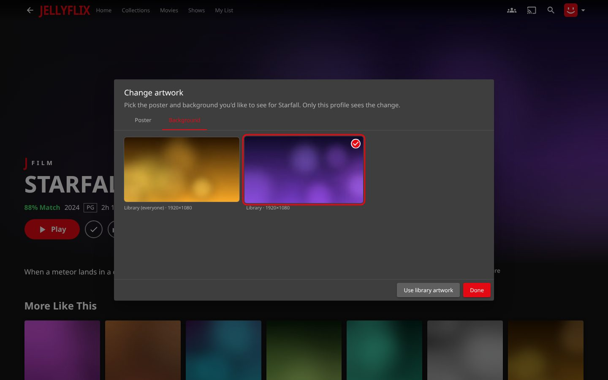</p>

- Images from providers are downloaded once into `jellyflix-artwork` in Jellyfin's data folder, so they keep working
  offline, and removed when no profile uses them any more. Only images a provider offers for that title can be chosen.
- Choices are kept per profile and forgotten when the profile is deleted. The library's metadata isn't touched.

## End-credit companion

When a movie finishes (it played to the credits, and nothing is queued after it), JellyFlix opens a companion page once
the player closes:

- **Next in *collection***: the following film in the movie's collection (a Jellyfin box set, ordered by release),
  with **Play** and **More info**.
- **Extras**: behind the scenes, featurettes, deleted scenes, interviews and other extras in the movie's folder.
- **Soundtrack**: who wrote the music, and soundtrack albums from the music library.
- **More Like This** from the recommendations.

<p align="center">
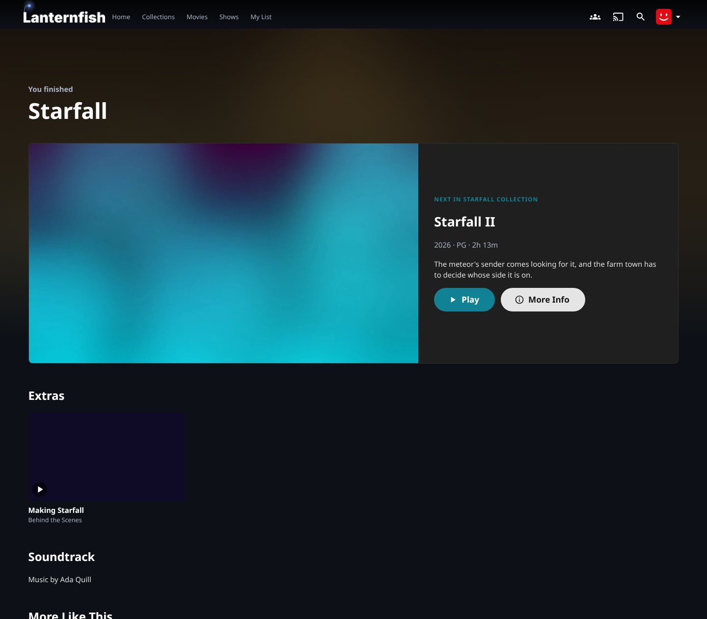

</p>

It works in TV mode too, with Play focused first. Back returns to where playback started.

## How the web updater works

- Releases are read newest first, and the check stops at the first one built for the running Jellyfin version
  (major.minor), so a check normally downloads one small `release.json` and, if it's new, the ~36 MB client.
- The **Update JellyFlix web client** scheduled task (Dashboard → Scheduled Tasks → JellyFlix) shows its progress
  while the client downloads. A download that stalls gives up after 15 minutes, so it never blocks later checks.
- Only releases built for the running Jellyfin version are installed, and every download is checked against the SHA-256
  published with the release.
- The new client is unpacked next to the old one and swapped in with a folder rename, so a failed update never leaves a
  half-written client. The installed build is recorded in `jellyflix-release.json`.
- It lives in `jellyflix-web` in Jellyfin's data folder (`/var/lib/jellyfin`, `/config` in Docker,
  `C:\ProgramData\Jellyfin\Server` on Windows). The plugin serves it through a small ASP.NET startup filter that runs
  ahead of Jellyfin's own web hosting; anything the build doesn't contain, and everything outside `/web`, is left to
  Jellyfin.

## How recommendations work

Titles become vectors of their genres, tags, studios, directors, writers, top cast and decade, weighted by kind and by
how rare each trait is in the library. A profile's taste is the weighted sum of what it watched, how far it got into
shows, its My List and its thumbs up/down, with recent activity counting more. Unwatched titles are ranked by
similarity to that taste plus a little rating and freshness, then re-ranked so one genre doesn't fill a row. New
profiles get well-rated, recently added titles. Only titles the profile may see are considered.

## API

All endpoints use the signed-in user's session.

| Method | Path | Description |
| --- | --- | --- |
| `GET` | `/JellyFlix/Profiles` | The household and its profiles. |
| `POST` | `/JellyFlix/Profiles` | Add a profile (owner). |
| `POST` | `/JellyFlix/Profiles/{id}` | Change a profile (owner, or the profile itself). |
| `DELETE` | `/JellyFlix/Profiles/{id}` | Remove a profile and its watch history (owner). |
| `POST` | `/JellyFlix/Profiles/{id}/Image` | Set a profile's photo; the body is a JPEG, PNG or WebP image up to 5 MB (owner, or the profile itself). |
| `DELETE` | `/JellyFlix/Profiles/{id}/Image` | Remove a profile's photo. |
| `POST` | `/JellyFlix/Profiles/{id}/Switch` | Switch this device to a profile (`{ Pin? }`). |
| `GET` | `/JellyFlix/Recommendations` | Top Picks and Because-you-watched rows. |
| `GET` | `/JellyFlix/Recommendations/Similar/{id}` | More Like This and the match percentage. |
| `GET` | `/JellyFlix/Requests/Search?query=` | Titles matching a search that aren't in the library, from Seerr or Ombi. |
| `POST` | `/JellyFlix/Requests` | Request a title (`{ TmdbId, MediaType: "movie" \| "tv" }`). |
| `POST` | `/JellyFlix/Requests/Test` | Check the request service's connection (administrators). |
| `GET` | `/JellyFlix/Search?query=&limit=` | Titles matching a description, best first. |
| `GET` | `/JellyFlix/Search/Status` | Search index status (administrators). |
| `POST` | `/JellyFlix/Search/Test` | Check the embeddings API (administrators). |
| `POST` | `/JellyFlix/Search/Build` | Start embedding new and changed titles (administrators). |
| `GET` | `/JellyFlix/Artwork` | The profile's chosen posters and backgrounds, by title. |
| `GET` | `/JellyFlix/Artwork/{id}/Options?kind=Poster\|Backdrop` | Artwork the profile can choose from. |
| `POST` | `/JellyFlix/Artwork/{id}` | Choose artwork for the profile (`{ Kind, OptionId }`). |
| `DELETE` | `/JellyFlix/Artwork/{id}?kind=` | Go back to the library's artwork. |
| `GET` | `/JellyFlix/Appearance` | The current season, its curated shelves for the profile, and whether dynamic colors are on. |
| `GET` | `/JellyFlix/Companion/{id}` | Next in the collection, extras and soundtrack for a title. |
| `GET` | `/JellyFlix/WebUpdate` | Web Updater status (administrators). |
| `POST` | `/JellyFlix/WebUpdate/Check` | Check for and install a web client now (administrators). |

## Versions

| Version | Changes |
| --- | --- |
| 1.4.0 | Ombi as a request service alongside Seerr. |
| 1.3.0 | Seasonal home pages (Halloween, Christmas, summer) with curated shelves, and the dynamic colors setting. |
| 1.2.1 | Profile avatars: generated icons (`AvatarIcon`) and photo uploads the household owner can make for any profile. |
| 1.2.0 | Search by description (with optional semantic search), artwork per profile, the end-credit companion. |
| 1.1.1 | Faster web client checks (stop at the first compatible release), download progress, a 15-minute download limit. |
| 1.1.0 | Requests through Seerr from search. |
| 1.0.1 | Serves the web client itself (no `--webdir`), removes the old separate plugins and carries their settings over. |
| 1.0.0 | Profiles, recommendations and the web updater in one plugin. |

## Development

The plugin builds against the JellyFlix server fork, included as the `jellyfin-server` submodule, so it always matches
the Jellyfin version it targets.

```sh
git clone --recurse-submodules https://github.com/yourmomsbasement/JellyFlix-Plugin.git
cd JellyFlix-Plugin
dotnet test JellyFlix.slnx
dotnet build src/JellyFlix -c Release   # → src/JellyFlix/bin/Release/net10.0/JellyFlix.dll
```

Releasing: push a tag such as `v1.2.0`, or run the **Release** workflow from the Actions tab with version `1.2.0`. The
workflow tests, builds `jellyflix_1.2.0.0.zip`, attaches it to a GitHub release and adds it to `manifest.json`, which
Jellyfin's catalog reads.
